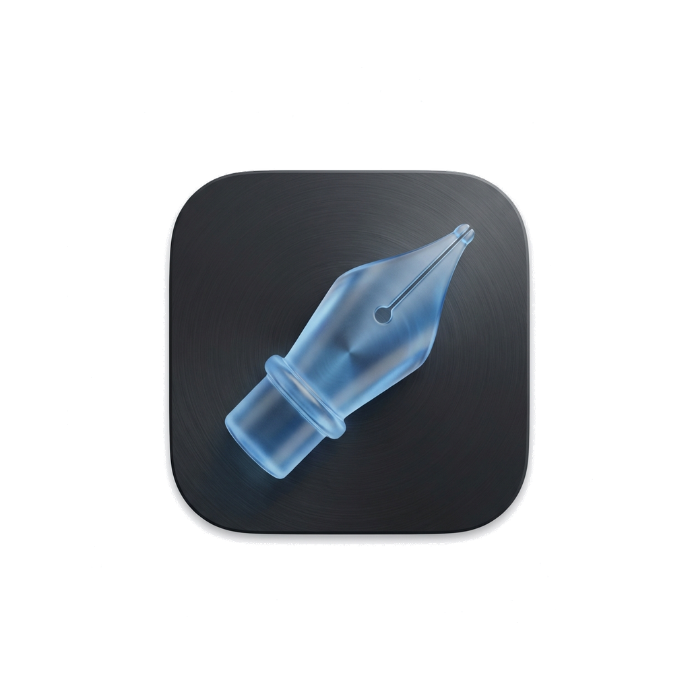

#  MDWriter

<p align="center">
  
</p>

<p align="center">
  <b>一款专为 macOS 打造的专业、原生、本地优先 Markdown 写作台。</b><br/>
</p>

<p align="center">
  
  
  
  
</p>

---
[English](./README.md)

MDWriter 是一款专为 macOS 深度定制的现代、沉浸且功能完备的原生 Markdown 写作台，完全采用 SwiftUI、SwiftData 和 TextKit 2 原生打造。灵感汲取自 Ulysses 与 Obsidian 等专业工具，将纯粹安静的创作环境与本地优先 AI 智能、双向链接、端侧多模态 OCR、外部本地文件夹挂载及全功能出版级排版工作流融为一体。

---

## ✨ v4.0 重大更新特性

### ⚡️ 编辑器内联 AI 助手与可视化 Diff 审阅 (`⌘K`)
* **光标悬浮指令栏**：在编辑器任意位置按下 `⌘K` 瞬间呼出 Apple 原生毛玻璃指令输入框。预设 8 项高频写作动作（润色、精简、扩写、语法纠错、双向翻译、商务语气、休闲语气、段落续写），或输入自然语言自由交互。
* **选区悬浮胶囊工具条**：划选任意文本，智能浮现流体动作胶囊，一键翻译、提炼或唤起 `⌘K`。
* **红绿行级 Diff 审阅卡片**：AI 生成的修改建议以行级红绿对比卡片直观呈现，支持字符/字数增减实时统计、统一视图与左右分栏切换，按下 `⏎` 采纳、`Esc` 放弃或 `⌘R` 重试，采纳前全自动创建去重版本安全快照。

### 🔍 本地向量语义检索 (Local RAG) 与 [[WikiLinks]] 双向知识网络
* **端侧句子向量语义检索 (Local RAG)**：完全基于 Apple 原生 `NaturalLanguage` 框架（中文 640 维、英文 512 维句子嵌入向量），实现全库段落级向量切片、增量内存缓存与关键字混合加权重排序（Hybrid Fusion），无需任何外部网络或第三方服务。
* **自主知识调用工具链**：AI 助手可在对话中自主调用 `semantic_search_library` 检索全库知识片段，并生成带匹配度与 `mdwriter://note/<id>` 的可点击跳转深度链接。
* **`[[WikiLinks]]` 双链与反向链接面板**：支持类似 Obsidian 的双向文档链接，输入 `[[文档标题]]` 即可跳转或一键创建新笔记。右侧大纲面板新增专属 Links Tab，实时检索引用当前文档的全部反向链接及上下文摘录。

### 👁️ 本地多模态视觉 OCR 与 Ghost Text 实时续写
* **Apple Vision 端侧多模态 OCR**：基于 Apple 原生 `VNRecognizeTextRequest` 框架，毫秒级离线高精度识别图片与 PDF 中的中英文，新增 `ocr_image_content` 工具，内置 Tool Calling 工具链扩充至 **29 个**。
* **Ghost Text 实时写作预测**：输入停顿 1.2s 自动防抖触发，智能结合上下文预测生成后续语句，以优雅半透明胶囊悬浮于底部，按下 **`Tab ⇥`** 键瞬间采纳。

### 📂 外部本地文件夹直接挂载与菜单栏全局速记
* **外部文件夹原地读写 (External Folders)**：利用系统 `Security-Scoped Bookmark` 挂载本地任意 Markdown 目录（如博客仓库、笔记文件夹）。磁盘修改双向自动同步，应用内编辑原子防抖写回磁盘对应 `.md` 文件。
* **菜单栏全局速记窗口 (`⌥⇧N`)**：常驻 macOS 系统菜单栏（`NSStatusItem`）笔墨图标，随时呼出极简毛玻璃卡片，按下 `⌘⏎` 瞬间保存至收集箱并自动收起。
* **CoreSpotlight 系统级搜索索引**：笔记标题、正文与标签全自动接入 macOS Spotlight 聚焦搜索，在系统任意位置搜索文档关键词，点击通过深度链接一键唤醒 MDWriter 并打开目标笔记。
* **macOS App Intents 快捷指令**：深度集成系统快捷指令（Shortcuts）与 Siri，提供新建笔记、搜索笔记、追加文本等系统动作。

### 🧮 LaTeX 数学公式、Mermaid 图表渲染与多文档合订导出
* **KaTeX & Mermaid 原生解析渲染**：行内与独立块数学公式（`$...$`, `$$...$$`）以及 Mermaid 流程图/时序图在导出 PDF、长图及预览中原生渲染为清晰矢量图。
* **多文档合订本导出 (Book Mode)**：支持按文件夹或手动排序，将多篇独立文档一键合并为包含规范总目录、层级章节标题与分隔线的完整合订部长文。
* **社交长图分享卡片**：一键生成精致排版的高清社交分享卡片图，支持主题色彩自适应。

---

## 🛠 核心功能矩阵

### 🧠 本地优先 AI 与本地大模型集成
* **通用本地模型引擎支持**：全量支持 Ollama、LM Studio、oMLX、llama.cpp、MLX、Jan 及自定义 OpenAI 兼容接口，数据 100% 本地运行不上云。
* **AI 对话面板 (`⇧⌘L`)**：右侧独立对话面板，支持多模型秒级切换、与笔记深度绑定的持久化会话历史，以及流式思考过程折叠 (`<think>`)。
* **29 个内置 Tool Calling 工具箱**：大模型可操控选区文本、管理文稿库笔记与文件夹、读取大纲、管理版本快照、检索向量切片及提取图片文本。
* **Model Context Protocol (MCP) 扩展支持**：基于 `mcp-swift-sdk @ 0.12.1` 实现原生 MCP 宿主，提供文件系统、网页抓取、Puppeteer 等预设扩展。
* **多引擎隐私网络搜索**：支持 DuckDuckGo（内置免 Key）、SearXNG、Brave、Tavily、Exa、Google、Bing 等 7 大搜索引擎，附带搜索来源引用卡片。

### ✍️ 专业 Ulysses 风格编辑器
* **排版至上**：针对英文与中日韩 (CJK) 文字定制的行高、段落间距与字体渲染规范。
* **8 款精选主题**：Pure, Solarized Light/Dark, GitHub, Dracula, Nord, Monokai, Night Owl。
* **打字机模式**：使当前光标所在行始终居中呈现，沉浸创作。
* **MarkX 引擎**：基于 TextKit 2 的高性能原生行内 Markdown 渲染，告别臃肿的 Web 视图。

### 📚 库与组织管理
* **SwiftData 数据库驱动**：现代化 SQLite 数据库架构，带来瞬间检索与可靠的数据完整性。
* **经典三栏式导航**：在分类列表、笔记目录与编辑区域之间自由切换。
* **全功能标签系统**：实时统计标签引用频次，点击即可秒级筛选。
* **文档置顶与模版库**：将关键文稿一键置顶于列表首位，支持从预设模版快速创建新笔记。
* **多重安全快照与备份**：AI 修改前自动去重版本快照、全库 AES-256 加密备份导出 (`.mdwbk`) 与 Dropbox 端到端加密 (E2EE) 云端同步。

---

## 🚀 安装指南

### 下载预编译应用
从 [Releases](https://github.com/SteveShi/MDWriter/releases) 页面获取最新的 **Universal Binary**（通用二进制，同时支持 Apple Silicon 与 Intel 芯片）。

### Homebrew 安装
```bash
brew tap SteveShi/tap
brew install --cask mdwriter
```

### 源码编译
**系统要求：** macOS 14.0+, Xcode 16.0+, [Tuist](https://tuist.io/)。

```bash
git clone https://github.com/SteveShi/MDWriter.git
cd MDWriter
tuist generate --no-open
xcodebuild -workspace MDWriter.xcworkspace -scheme MDWriter -configuration Debug -destination 'platform=macOS' build
```

---

## 📦 技术栈

- **SwiftUI & SwiftData**：macOS 原生声明式界面与现代化持久化体系。
- **MDEditorKit**：基于 TextKit 2 构建的高性能 Markdown 原地行内编辑组件。
- **Apple NaturalLanguage & Vision**：端侧句子向量嵌入与离线文本多模态识别。
- **Apple AppIntents & CoreSpotlight**：系统快捷指令与 Spotlight 聚焦搜索集成。
- **mcp-swift-sdk**：Model Context Protocol 客户端标准实现。
- **Sparkle 2**：流畅的原生 macOS 自动更新与双语更新日志发布机制。

---

## 📄 授权协议

MDWriter 基于 **Mozilla Public License 2.0 (MPL-2.0)** 开源协议分发。
